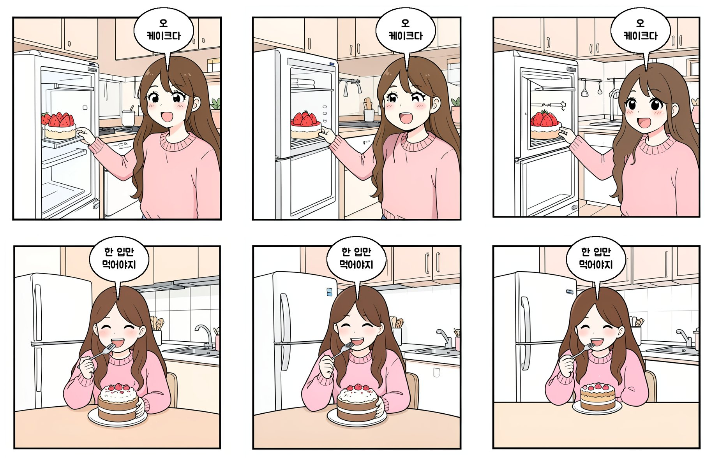
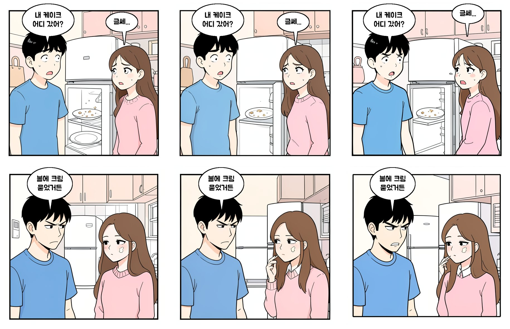

# 실험: FLUX.2 klein 한글 말풍선 4컷 생성 검증

- 날짜: 2026-11-05 ~
- 담당: 민주
- 이슈: #6
- 브랜치: `feature/6-exp-flux-klein-korean`
- 커밋: (결과를 낸 코드의 커밋 해시)

## 목적

LoRA 학습 전에, FLUX.2 klein이 아키텍처 요구대로 **말풍선과 한글 대사를 직접** 그릴 수 있는지,
그리고 **Jetson Orin Nano(8GB 통합 메모리)**에서 돌아가는지 확인한다.

가설: 짧은 대사는 정확히 그리지만, 대사가 길어질수록 글자가 깨진다. Orin Nano에서는 양자화가 필요하다.

## 설정

- 베이스 모델: **FLUX.2 klein 4B** (Apache 2.0)
  - 추론 검증: 4B distilled (적은 스텝으로 빠르게 생성)
  - LoRA 학습(E5): 4B base
  - 9B는 비상업 라이선스이고 메모리 부담이 커서 제외
  - 공식 수치: 추론 약 8–13GB(bf16, 자료마다 다름), LoRA 학습 VRAM 12GB + RAM 32GB
- 데이터: 학습 없음. 테스트 프롬프트 세트 (`prompts.yaml`)
  - 대사 길이: 짧음(≤5자) / 중간(6–15자) / 김(16자 이상)
  - 말풍선 수: 1개 / 2개(대화)
  - 구성: 한 장에 4컷 / 컷별 1장
- 방법: 추론만 (LoRA 없음)
- 환경: 3090 서버(품질 기준) → Orin Nano(메모리·속도)
  - 3090 서버는 PyPI가 막혀 있어 카카오 미러로 따로 설치함(레포 `uv.lock`과 버전이 다름)
  - torch 2.14.1+cu130, diffusers 0.42.1, transformers 5.19.0 — 전체 목록 `requirements-server.txt`
  - 재현: `uv venv --python 3.12 .venv && UV_DEFAULT_INDEX=https://mirror.kakao.com/pypi/simple uv pip install -r requirements-server.txt`
  - 실행은 `uv run --no-sync` 또는 `.venv/bin/python` (그냥 `uv run`은 PyPI에 접속하려다 실패함)

## 측정 항목

| 항목 | 방법 |
|---|---|
| 한글 정확도 | OCR 문자 오류율(CER) + 사람 평가(정확 / 일부 틀림 / 못 읽음) |
| 말풍선 배치 | 사람 평가 (대사가 말풍선 안에 있는가, 화자와 맞는가) |
| 메모리 | 최대 사용량 (Orin Nano는 `tegrastats`) |
| 속도 | 이미지 1장 생성 시간, 4컷 전체 시간 |

## 결과

### 3090 서버 (4B distilled, bf16, 1024×1024, 4스텝, 시드 0·1·2)

- 속도: 이미지 1장 약 **2.7초**, 모델 로드 3.4초
- GPU 최대 메모리: **17.3GB** (텍스트 인코더 Qwen3 약 8GB + 이미지 모델 약 7.8GB, 모두 GPU에 올림)

| 케이스 | 정확히 그린 수 | 실제로 그린 글자 (시드 0 / 1 / 2) |
|---|---|---|
| 짧음 `배고파` | 0/3 | 배고마 / 맴모다 / 바됴더 |
| 짧음 `헐 대박` | 0/3 | 횔츠 미뭄 / 쿨다 / 곁뭄 대팜 |
| 짧음 `진짜?` | 0/3 | 진미? / 절머? / 점미? |
| 중간 (3개) | 0/9 | 한글처럼 생긴 엉뚱한 글자 |
| 김 (2개) | 0/6 | 읽을 수 없음 |
| 대화 2개 말풍선 (2개) | 0/6 | 말풍선 배치는 맞지만 글자는 틀림 |
| 한 장에 4컷 | 0/3 | 4컷 구성, 이야기 흐름은 좋음. 글자는 틀림 |
| **합계** | **0/33** | |

OCR은 생략함: 사람이 봐도 정답이 하나도 없어 문자 오류율을 잴 필요가 없었다.

### 대조 실험 (템플릿의 한글 지시 문장 없이)

| 케이스 | 결과 |
|---|---|
| 영어 `I'm so hungry` | 0/3 정확. "I'm so Hunghy / humgy" 정도로 비슷하지만 철자가 틀림 |
| 빈 말풍선 1개 | **3/3 깨끗하게 비어 있음** |
| 빈 말풍선 2개 | **3/3 깨끗하게 비어 있음**, 인물마다 꼬리 방향도 맞음 |

주의: 처음 대조 실험에는 템플릿의 "Korean text ... must be written exactly" 문장이 함께 들어가, 빈 말풍선에도 가짜 한글이 채워졌다. 이 문장을 빼고(`raw: true`) 다시 돌린 결과가 위 표다.

### 대안 시제품: 빈 말풍선 + 대사 합성 (`src/lolog_ai/bubble.py`)

FLUX가 그린 빈 말풍선을 찾아 대사를 한글 폰트(Jua, OFL)로 넣는다. numpy와 Pillow만 써서 Jetson에서도 그대로 돌아간다.

- 말풍선 찾기: 밝은 영역을 연결 요소로 묶고, 크기, 가장자리 접촉, **타원 IoU ≥ 0.85**로 거른다
  - 진짜 말풍선 IoU 0.89–0.99, 오탐(흰 옷, 냉장고 문) 0.70–0.79
  - IoU 조건이 없을 때는 6장 중 3장에서 오탐이 생겼다. 조건을 넣은 뒤 **6/6 정확**
- 대사 넣기: 띄어쓰기 기준 줄바꿈, 말풍선 안 사각형(타원 bbox의 72%)에 들어가는 가장 큰 글자 크기를 자동으로 고른다
- 결과: 대사 18개(짧음, 중간, 긴 대사, 2인 대화) **18/18 정확**. 6장 처리에 약 3초(CPU)
- 한계: 빈 말풍선 이미지 6장으로만 확인했다. 말풍선과 화자는 왼쪽→오른쪽 순서로 짝짓는다(화자 위치를 프롬프트로 고정해야 함). 4컷 한 장 이미지와 LoRA 적용 후에는 다시 확인해야 한다

### 컷 배치 비교와 대사 최대 길이 (`scripts/layout_test.py`)

같은 이야기(냉장고 케이크, 4컷, 말풍선 5개)를 세 방식으로 시드 3개씩 그렸다. 대사 길이는 "최종 이미지를 폰 가로 1080px에 맞춰 볼 때 글자 크기 36px(약 12sp) 이상"으로 넣을 수 있는 최대 글자 수다.

| 방식 | 생성 시간 (3090) | 인물 | 말풍선 찾기 | 말풍선 하나에 들어가는 대사 |
|---|---|---|---|---|
| 한 장에 2×2 (1024²) | 2.8초 | 컷마다 같은 인물이 둘로 복제됨 (3/3 시드) | 4–6/5, 컷 배정이 섞임 | **7–11자** |
| 한 장에 세로 4칸 (512×2048) | 2.7초 | 이야기 순서와 인물 수 맞음 | 0–1/5 (찾기 코드가 세로 비율을 못 다룸) | 측정 불가 |
| 컷마다 따로 그려 합침 (768² ×4) | 6.3초 | **컷마다 인물 수·외모 맞음** | 3–5/5 | 2×2로 합치면 4–14자 / **세로 4칸이면 27자 이상** |

- 2×2는 폰에서 컷 하나가 화면 절반 너비라 대사가 10자 안팎으로 짧아진다. 세로 4칸은 컷이 화면 전체 너비라 25자 대사도 읽을 수 있는 크기로 들어간다.
- 컷마다 따로 그리면 외모 설명(`appearance`)만으로도 4컷 내내 인물이 비슷하게 나왔고, 컷 3처럼 두 사람이 나오는 컷도 정확했다. 대신 시간은 4배다.
- 말풍선 찾기는 5개 중 3–5개라 보완이 필요하다(찾지 못하면 코드가 말풍선을 직접 그리는 대체 방식 등).

### 말풍선 만드는 방식 비교 (`scripts/bubble_method_test.py`)

팀 명세(TR-07: 그림 모델은 글자·말풍선 없이 그리고, 말풍선과 대사는 워커가 코드로 붙임)와 위 시제품을 같은 조건에서 비교했다.

- A `bubble_model`: 프롬프트로 빈 말풍선을 그리게 하고 `find_bubbles`로 찾아 대사를 넣는다 (위 시제품)
- B `bubble_code`: "No text, no letters, no speech bubbles"로 그리고 `place_bubbles`/`draw_bubbles`가 말풍선을 그린다
  - 크기: 대사 길이로 정함, 모든 컷 같은 글자 크기(32px, 폰 기준 약 14sp)
  - 자리: 화자(`cast.position`) 위쪽에서 선이 적은 곳, 위쪽일수록 우선. 읽는 순서(왼→오, 위→아래)를 지키고 서로 겹치지 않음
  - 꼬리: 화자 쪽으로
- 입력: 팀 명세 형식 콘티 2개(`storyboards/cake.json` = 팀 예시, `storyboards/wallet.json` = 3명·가운데 위치·대사 없는 컷·긴 대사), 시드 0·1·2, 컷 768², 세로 4칸
- 대사가 있는 컷 21개, 말풍선 30개

| | A 모델이 빈 말풍선 | B 코드가 말풍선 (팀 명세) |
|---|---|---|
| 대사가 들어간 말풍선 | 24/30 | **30/30** |
| 빈 말풍선이 남은 컷 | 5/21 | 0/21 |
| 대사가 다른 사람 말풍선에 들어간 컷 | 2/21 (wallet 4컷: 말 안 한 사람에게) | **0/21** (콘티 위치로 정하므로) |
| 말풍선이 얼굴을 가린 컷 | 0/21 | **4/21** (wallet 4컷 3명 장면 ×3, cake 시드2 4컷) |
| 글자 크기 | 말풍선마다 다름(크고 굵음) | 모든 컷 같음(작은 편) |
| 생성 시간 (3090, 컷 1장) | 1.6초 | 1.6초 |
| 말풍선 처리 (CPU) | 0.1초 이하 | 0.2초 이하 |

- A의 실패는 모두 "모델이 말풍선 수를 안 지키거나, 그렸지만 찾지 못함"이다. 대사가 빠지거나 엉뚱한 사람에게 가서 이야기가 틀어진다. 코드로 고치기 어렵다(모델 동작에 달림).
- B의 실패는 "말풍선이 얼굴을 가림" 하나다. 인물 3명이 화면을 꽉 채운 컷에서 주로 생겼다. 얼굴은 선이 적어서 "선이 적은 곳" 점수로 못 피한다. 대사는 항상 정확하게 들어간다.
- 주의(프롬프트): B에 "위쪽을 비워 둬(Leave plain empty space in the upper part)"를 넣었더니 FLUX가 컷 위에 **빈 칸을 하나 더 그려** 컷 안에 컷이 생겼다(첫 실행, 6/6 시드). 이 문장을 빼고 다시 돌린 결과가 위 표다.
- B에서도 간판 같은 배경에 가짜 글자는 생긴다(A도 같음). 말풍선 안에 가짜 글자가 생긴 경우는 두 방식 모두 없었다.

결론: **팀 명세(B)로 정했다** (LOLog-docs#4에 반영). 대사가 빠지거나 다른 사람에게 가는 A의 실패는 이야기를 망치지만, B의 실패(얼굴 가림)는 코드로 고칠 수 있다.

### B 보완: 얼굴 피하기 (`src/lolog_ai/faces.py`, `scripts/bubble_face_test.py`)

위 실험에서 저장한 B 원본 컷(말풍선 넣기 전)에 말풍선을 다시 넣어 비교했다(그림은 같고 말풍선만 다름).

얼굴 검출기 고르기 (B 원본 컷 24장, 인물 39명):

| 검출기 | 찾은 얼굴 | 비고 |
|---|---|---|
| 피부색 마스크 | - | 노란 옷·간판이 잡히고 얼굴은 일부만 잡혀 탈락 |
| OpenCV `lbpcascade_animeface` | 13/39 | 큰 눈의 여자 얼굴만 찾음. 남자·안경은 거의 놓침 |
| **`deepghs/anime_face_detection` v1.4_s** (YOLOv8, MIT) | **39/39** | 오탐 4개는 창문 안 작은 배경 사람(피해도 됨). onnxruntime CPU 한 장 약 60ms |

- ONNX 입력 크기가 고정되지 않은 형식이라 OpenCV DNN으로는 못 읽고 `onnxruntime`(CPU)을 쓴다. Jetson(aarch64)용 패키지도 PyPI에 있다
- 모델 파일: `~/.cache/lolog/models/animeface/model.onnx` (43MB, 레포에 넣지 않음)
  - 받기: `https://huggingface.co/deepghs/anime_face_detection/resolve/main/face_detect_v1.4_s/model.onnx`

자리 고르기에 더한 것:
- 얼굴(상자를 15% 넓혀서)을 덮는 자리에 큰 벌점
- 얼굴을 왼쪽→오른쪽으로 `cast.position`과 짝지어, 말풍선을 화자 얼굴 근처에 두고 꼬리를 화자 얼굴로 향하게 함
- 화자보다 다른 인물 얼굴에 더 가까운 자리, 말하지 않은 인물의 몸 위 자리에 벌점
- 글자 32px → 36px (폰 기준 약 15sp)

| | 전 (32px, 선이 적은 곳만) | 후 (36px, 얼굴 검출) |
|---|---|---|
| 얼굴을 가린 컷 (대사 있는 21컷) | 4 | **0** (자동 측정 + 눈으로 확인) |
| 화자와 짝지은 컷 | - | 21/21 |
| 처리 시간 (CPU, 컷 1장) | 0.2초 | 얼굴 0.08초 + 자리 0.24초 |

남은 문제: **인물 3명 + 대사 2개** 컷(wallet 4컷)은 두 번째 말풍선이 들어갈 자리가 마땅치 않아, 6장 중 4장에서 엉뚱한 인물 옆으로 밀려 그 사람 말처럼 보였다.
- 대사 순서와 인물 위치를 맞춰(먼저 말하는 사람을 왼쪽에) 다시 그려도 3장 중 2장이 같았다 → 순서 규칙으로는 해결되지 않음
- 같은 컷에서 대사를 1개만 넣으면 6/6 화자가 분명했다. 인물 2명 + 대사 2개 컷(cake 3컷, wallet 3컷)도 6/6 괜찮았다

제안: 콘티 검사 규칙에 **"인물이 3명인 컷은 대사 1개까지"**를 더한다 (LOLog-docs `storyboard.md` 검사 규칙, ai `storyboard.py`).

### Orin Nano (`scripts/jetson_bench.py`)

실제 서비스 순서 그대로 4컷 한 장을 만드는 데 드는 메모리와 시간을 쟀다. 텍스트 인코더로 프롬프트 4개를 인코딩하고 인코더를 지운 뒤, 이미지 모델과 VAE를 올려 컷 4장을 그리고, 컷마다 얼굴 검출과 말풍선을 넣어 세로 4칸으로 합친다.

- 장비: Jetson Orin Nano 8GB (통합 메모리 7.5GB), L4T R39.2.1, 전원 모드 15W, `jetson_clocks` 적용, 스왑 `/swapfile` 8GB
- 패키지: torch 2.15.0, diffusers 0.42.0.dev0, transformers 5.22.1, torchao 0.18.0, bitsandbytes 0.50.2, gguf 0.19.0, onnxruntime 1.31.1
- 입력: `storyboards/cake.json`, 시드 0·1·2, 컷 768², 4스텝, 글자 36px. 설정마다 준비 실행(warmup) 1번은 결과에서 뺐다
- 메모리: `/proc/meminfo`로 시스템 전체 사용량을 0.2초 간격으로 기록했다(CPU와 GPU가 같은 메모리를 쓰므로 torch 수치만으로는 부족하다). torch 최대값은 참고용
- 측정 조건: 데스크톱(GUI), VS Code 서버, InfluxDB 컨테이너를 끄고 일반 SSH의 tmux에서 실행했다. 설정마다 새 프로세스로 돌리고, 그 전에 스왑과 페이지 캐시를 비웠다
- 원본 결과: `results/orin-nano/<설정>/summary.json`(단계별), `panels.csv`(컷별)

| 설정 (텍스트 인코더 / 이미지 모델) | 4컷 1장 (중앙값) | 컷 1장 생성 | 디코딩 | 준비 시간 (로드~warmup) | 최대 RAM | 최대 스왑 | torch 최대 |
|---|---|---|---|---|---|---|---|
| int8 / int8 (torchao) | 109초 | 23.2초 | 3.1초 | 271초 | 7.35GB | 803MB | 4.9GB |
| **nf4 / nf4 (bitsandbytes)** | **94.5초** | **21.1초** | 1.6초 | 236초 | 7.24GB | 150MB | **3.6GB** |
| nf4 / GGUF Q4_K_M | 136초 | 31.5초 | 1.6초 | **186초** | 7.15GB | 112MB | 4.1GB |

- 얼굴 검출(컷 1장 약 0.3초)과 말풍선(0.3–0.6초)은 설정과 관계없이 같다. 4컷 시간의 대부분은 이미지 생성이다
- 텍스트 인코더 로드가 가장 무겁다: int8은 106초에 RAM 6.1GB, nf4는 98초에 4.3GB. bf16 원본을 읽은 다음 양자화하기 때문이다
- 최대 RAM은 세 설정 모두 7.1–7.4GB로, warmup(VAE 디코딩 + 얼굴 검출 모델 첫 로드)에서 올라간다
- GGUF는 이미지 모델 로드가 34초로 가장 빠르지만(미리 양자화된 파일), 생성 중에 가중치를 풀어 쓰느라 컷마다 nf4보다 10초 느리다
- GGUF 파일: `flux-2-klein-4b-Q4_K_M.gguf` (2.6GB, `~/.cache/lolog/gguf/`, 레포에 넣지 않음)

화질 (같은 시드끼리 비교, 왼쪽부터 int8 / nf4 / gguf-q4):

- 세 설정 모두 인물 외모·표정·그림체, 말풍선 자리와 대사가 거의 같다. int8과 nf4는 차이를 찾기 어렵다
- gguf-q4는 자잘한 깨짐이 조금 더 있다: 냉장고 안 가짜 글자(시드 0의 1컷), 컷 테두리가 이중으로 그려짐(시드 1의 2컷)
- 세 설정 공통: 냉장고 속 딸기 케이크가 2컷에서 초코 케이크로 바뀐다. 양자화가 아니라 컷마다 프롬프트를 따로 넣어서 생기는 문제다(콘티에 소품 모양을 같이 적어야 함)

측정하면서 겪은 문제:
- 첫 int8 실행은 warmup에서 "tensors on different devices"로 실패했다. torchao 양자화 모델은 로드 후 CPU에 남아 있어서, nf4가 아닌 설정은 직접 GPU로 옮기도록 고쳤다
- 메모리가 꽉 차면(RAM 7.2GB + 스왑) sshd와 VS Code 서버가 스왑으로 밀려나 SSH 접속이 끊겼다. VS Code 서버(약 1.1GB)를 끄고 tmux에서 돌려 해결했다(시작 RAM 2.6GB → 1.3GB)
- 측정 중에 `swapoff -a`를 실행하면 스왑을 RAM으로 되돌릴 자리가 없어 Jetson이 멈춘 뒤 재부팅된다. 스왑 비우기는 측정과 측정 사이에만 한다

결론: **Orin Nano에서는 nf4 / nf4로 정한다.** 4컷 한 장 약 95초(컷당 약 24초), 스왑 150MB로 가장 빠르고 안정적이며 화질 차이는 없다. 다만 4컷 생성 혼자 RAM 7.2GB를 쓰므로 웃음 감지·화자 분리는 다른 Jetson에 둔다.

체크포인트 위치: 해당 없음 (베이스 모델만 사용)

## 결론과 다음 할 일

- 베이스 모델은 한글은 물론 영어 철자도 정확히 그리지 못한다. 대사를 직접 그리는 방식은 그대로 쓸 수 없다.
- 반면 그림체, 말풍선 위치와 꼬리 방향, 4컷 구성은 좋고, 빈 말풍선 요청도 잘 지킨다.
- 빈 말풍선 + 대사 합성 방식으로 대사를 100% 정확하게 넣을 수 있음을 확인했다.
- 그 뒤 팀 명세 방식(말풍선도 코드로)과 비교했더니, 빈 말풍선 방식은 말풍선 30개 중 6개에 대사가 들어가지 못했고 코드 방식은 30/30이었다. **FLUX는 글자·말풍선 없이 그림만, 말풍선과 대사는 코드로(팀 명세 TR-07) 하는 방식을 제안한다.**
- LoRA는 한글 쓰기보다 그림체와 캐릭터 일관성 학습(E5)에 쓴다.
- 말풍선은 만화 얼굴 검출로 얼굴을 피해 놓는다. 얼굴 가림 4/21 → 0/21.
- Orin Nano에서 FLUX(nf4 / nf4) + 얼굴 검출 + 말풍선으로 4컷 한 장에 약 95초, 최대 RAM 7.2GB. 4컷 생성은 Jetson 한 대를 혼자 쓴다.
- 다음: (1) "인물 3명 컷은 대사 1개" 규칙 팀과 정하기 / (2) 아키텍처 그림 고치기 / (3) 텍스트 인코더를 미리 양자화해 저장해서 로드 시간과 RAM 줄이기 / (4) 콘티에 소품 모양을 적어 컷 사이 일관성 확인
