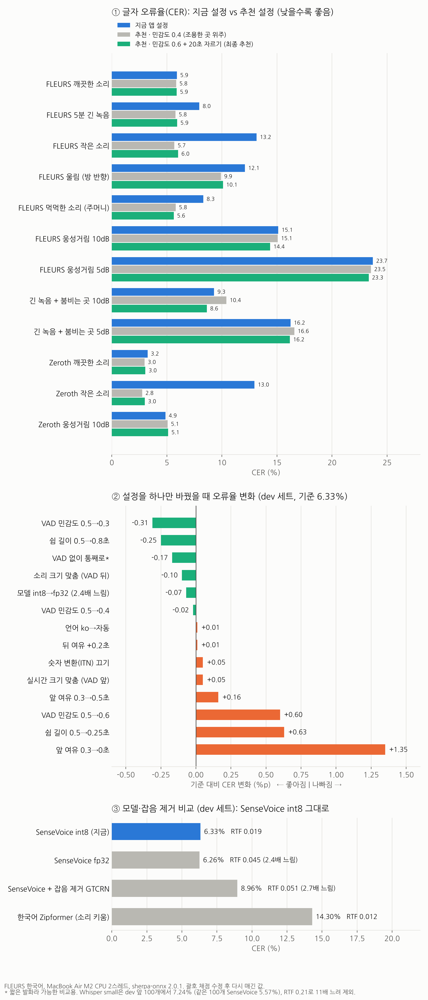

# 실험: 폰 안 한국어 STT 성능 올리기

- 날짜: 2026-11-09
- 담당: 민주
- 브랜치: `claude/project-thread-unkspz`

## 목적

앱이 쓰는 폰 안 STT(sherpa-onnx SenseVoice-Small int8 + silero VAD, 구간 앞 0.3초 붙이기)의
지금 성능을 오픈소스 데이터로 재고, 폰 제약(CPU 2~4스레드) 안에서 설정·모델을 하나씩 바꿔 가며 올린다.
SenseVoice는 프롬프트를 받지 않으므로 바꿀 수 있는 것은 언어 고정, ITN, VAD 값, 입력 크기 맞춤, 모델, 후처리다.

## 데이터 (오픈소스만)

| 세트 | 내용 | 용도 |
|---|---|---|
| `fleurs-dev` | FLEURS ko_kr dev 226발화 | 설정 고르기(튜닝) |
| `fleurs-clean` | FLEURS ko_kr test 382발화 | 확인용 |
| `fleurs-babble10` / `babble5` | test + 다른 화자 3명 웅성거림 SNR 10/5dB | 시끄러운 자리 |
| `fleurs-quiet` | test를 -20dB로 | 폰이 멀거나 주머니 속 |
| `fleurs-longform` | test 발화를 쉼과 함께 이어 붙인 5분 녹음 18개 | 앱처럼 VAD로 잘라 인식 |
| `zeroth-*` | Zeroth-Korean test 457발화 (`--zeroth`) | 다른 화자·녹음 조건 |

FLEURS는 CC-BY-4.0, `storage.googleapis.com`에서 받는다. Zeroth-Korean은 CC-BY-4.0, HF `kresnik/zeroth_korean`.

채점: 주 지표는 띄어쓰기를 뺀 CER(%). 문장부호·따옴표는 빼고, 기준 글의 괄호 속 원어 표기(`비슈케크(Bishkek)`)는 읽지 않으므로 뺀다. 괄호 안에 한글이 있으면 실제로 읽은 내용이라 남긴다(dev 9개, test 22개 문장. 처음 측정 때는 이것도 빼서 CER이 조금 부풀려졌고, 다시 채점한 값으로 바꿀 예정).
FLEURS 기준 글은 숫자를 아라비아 숫자로 적는다(test 382개 중 86개에 숫자). 그래서 ITN을 끄면 "백 퍼센트" vs "100%"가 틀린 글자로 잡힌다.

속도: RTF = 처리 시간 / 소리 길이. `--threads`로 스레드 수를 묶는다(리눅스는 코어도 고정).
맥 M 계열은 중급 안드로이드보다 2~3배 빠르므로 RTF 절댓값보다 설정 간 비교로 본다.

## 돌리는 법

```bash
pip install sherpa-onnx soundfile numpy   # Zeroth까지: huggingface_hub pyarrow
bash fetch_models.sh                       # models/ 에 모델 받기 (github.com)
python -I prepare_data.py --out data/stt   # FLEURS 받아 세트 만들기 (약 1.8GB)
python -I prepare_data.py --out data/stt --zeroth --realistic --crowd --crowd-norm   # 4차 이후 세트 (scipy 필요)
python -I run_bench.py --set fleurs-dev --model sensevoice-int8 --threads 2 --tag baseline

# 최종 추천 설정 A
python -I run_bench.py --set fleurs-longform --model sensevoice-int8 --threads 2 --tag A \
  --lang ko --itn 1 --vad-threshold 0.6 --min-silence 0.8 --pad 0.3 \
  --gain agc --gain-scope file --agc-noise-ceil-db -50 --agc-noise-init first --hard-max-speech 20
```

`--gain agc`는 앞만 보는 실시간 방식이라 `--gain-scope file`(VAD 앞에 적용)이어도 폰에서 그대로 쓸 수 있다.

결과는 `results.jsonl`에 쌓이고, 아래 표에 옮긴다.

## 결과 (1차, 2026-11-09 15:36~16:43, 44번 실행)

환경: MacBook Air M2(성능 4 + 효율 4코어) 16GB, 전원 연결, sherpa-onnx 2.0.1, `--threads 2`, 한 번에 하나씩 실행. 같은 설정의 RTF가 1시간 내내 같아서(0.0185 → 0.0184~0.019) 발열로 느려진 흔적은 없다.
기준 설정(지금 앱): `sensevoice-int8 --lang ko --itn 1 --vad silero --vad-threshold 0.5 --min-silence 0.5 --max-speech 20 --pad 0.3`.

> 이 문서의 "기준"·"지금 앱 설정"은 위 값이다. 실제 앱(LOLog-app `SttEngine.kt`)은 `minSilence 0.25`, ITN 끔이다. dev에서 min-silence 0.25는 0.5보다 약 0.6%p 나쁘고, ITN은 CER을 0.05%p 안쪽으로만 바꾼다. 그래서 실제 앱에서 추천 설정 A로 바꿀 때 좋아지는 폭은 이 문서의 숫자보다 조금 더 크다.
CER은 띄어쓰기를 뺀 값(%). 괄호 채점 수정 뒤 저장된 발화별 결과로 다시 매긴 값이고, 괄호 안은 처음 채점 값이다.

### A. 기준 성능

| 세트 | CER | RTF | 빈 결과 |
|---|---|---|---|
| fleurs-dev | 6.33 (6.92) | 0.0185 | 0 |
| fleurs-clean | 5.91 (6.16) | 0.0181 | 0 |
| fleurs-babble10 | 15.12 (15.42) | 0.0230 | 3 |
| fleurs-babble5 | 23.71 (23.92) | 0.0233 | 2 |
| fleurs-quiet | 13.15 (13.36) | 0.0176 | 9 |
| fleurs-longform (89분) | 7.95 (8.07) | 0.0172 | 0 |

### B. 하나만 바꾸기 (fleurs-dev, 기준 6.33)

| 바꾼 것 | CER | 비고 |
|---|---|---|
| `--vad-threshold 0.3` | **6.02** | 가장 좋음 |
| `--min-silence 0.8` | 6.08 | |
| `--vad none` | 6.16 | 짧은 발화라 가능한 비교용 |
| `--gain rms` (VAD 뒤) | 6.23 | |
| `--model sensevoice-fp32` | 6.26 | RTF 0.045, 2.4배 느림 |
| `--vad-threshold 0.4` | 6.31 | |
| `--lang auto` | 6.34 | 차이 없음 |
| `--tail-pad 0.2` | 6.34 | 차이 없음 |
| `--itn 0` | 6.38 | 차이 없음. SenseVoice ITN은 한국어 숫자를 거의 안 바꾼다("오십6까지" 같은 섞인 결과) |
| `--pad 0.5` | 6.49 | |
| `--vad-threshold 0.6` | 6.93 | |
| `--min-silence 0.25` | 6.96 | 구간이 잘게 쪼개짐 |
| `--pad 0` | 7.68 | 앞 여유가 없으면 첫 글자가 잘림 |
| `--model whisper-small` (앞 100개) | 7.24 | 같은 100개에서 SenseVoice 5.57. RTF 0.21, 11배 느림 |
| `--model zipformer-ko` | 48.49 | 빈 결과 75개. 아래 H 참고 |

### C. 작은 소리·시끄러운 소리

| 바꾼 것 | quiet (기준 13.15) | babble5 (기준 23.71) |
|---|---|---|
| `--gain rms` (VAD 뒤) | 13.06 | 23.18 |
| `--gain rms --gain-scope file` (VAD 앞) | **5.78** (빈 결과 9→0) | 23.75 |
| `--vad-threshold 0.3` | 8.89 | 23.80 |

### D. 긴 녹음 VAD 값 (fleurs-longform, 기준 7.95)

`--max-speech 10` 7.96 / `30` 7.95 / `--min-silence 0.25` 8.23 / `0.8` 7.82

### E. 4스레드

CER 같음, RTF 0.0164 (2스레드보다 11% 빠름).

### F. 실시간 크기 맞춤 `--gain agc --gain-scope file` (VAD 앞, 앞만 보고 결정해서 폰에서 그대로 쓸 수 있음)

quiet 5.83 (13.15) / longform 6.06 (7.95) / dev 6.38 (6.33) / babble5 24.27 (23.71)

### G. 묶음 설정 `--vad-threshold 0.3 --min-silence 0.8 --gain agc --gain-scope file`

| 세트 | 기준 | 묶음 | 차이 |
|---|---|---|---|
| fleurs-dev | 6.33 | 5.88 | -0.45 |
| fleurs-clean | 5.91 | 5.72 | -0.19 |
| fleurs-quiet | 13.15 | 5.71 | -7.44 |
| fleurs-longform | 7.95 | 5.73 | -2.22 |
| fleurs-babble10 | 15.12 | 16.65 | +1.53 |
| fleurs-babble5 | 23.71 | 24.53 | +0.82 |

### H. 한국어 Zipformer가 48%로 나온 이유

모델·토큰 파일 짝은 맞다(모델에 들어 있는 예제 wav는 int8·fp32 모두 정확히 인식). 빈 결과 75개는 아주 작게 녹음된 발화(최대 진폭 중앙값 0.023, 나머지는 0.13)였고 fp32·beam search에서도 똑같이 비었다. 소리를 키우면 정상 인식된다: dev `--gain peak` 14.30, `--gain agc` 14.73 (RTF 0.012, 빈 결과 0). 그래도 SenseVoice(6.33)보다 두 배 넘게 나쁘다.

## 결론 (1차)

1. **모델은 SenseVoice int8을 그대로 쓴다.** fp32는 거의 같은데 2.4배 느리고, Whisper small은 더 나쁘고 11배 느리고, 한국어 Zipformer는 두 배 넘게 나쁘다.
2. **가장 큰 개선은 VAD 앞에서 소리 크기를 맞추는 것이다.** 작은 소리 13.15 → 5.8, 긴 녹음 7.95 → 6.1. VAD 뒤에서 키우면 효과가 없다. 작은 소리에서 나빠지던 원인은 모델이 아니라 VAD가 말소리를 놓치는 것이었다.
3. **VAD 값은 민감도 0.3, 쉼 0.8초가 좋다.** 앞 여유 0.3초는 지금 값이 맞다(0이면 +1.35). 언어 고정(ko)·ITN·뒤 여유·최대 구간 길이는 거의 영향이 없다.
4. **묶음 설정은 조용한 환경에서 모두 좋아진다**(긴 녹음 7.95 → 5.73). **대신 웅성거림 속에서는 0.8~1.5 나빠진다.** 크기 맞춤이 배경 웅성거림까지 키우고, 민감도 0.3이 그걸 말소리로 받아들이는 것으로 보인다.
5. 처리 속도는 RTF 0.02 안팎으로 여유가 크다. 폰이 2~3배 느려도 1시간 녹음을 3분 안쪽에 처리하는 수준이다(어림).

## 2차: 웅성거림 속 손해 잡기 (2026-11-09 16:51~22:46, 32번 실행)

1차 묶음 설정은 웅성거림에서 기준보다 나빴다. 원인을 나눠 보고 고친다. 새로 넣은 옵션: `--agc-max-gain`, `--agc-noise-ceil-db`, `--agc-noise-init first`, `--denoise gtcrn`.

### 2-1. 묶음에서 VAD 민감도만 바꾸기 (쉼 0.8초 + agc 고정)

| 세트 | 기준 | 민감도 0.3 (묶음) | 0.4 | 0.5 |
|---|---|---|---|---|
| dev | 6.33 | 5.88 | 5.94 | 6.03 |
| babble10 | 15.12 | 16.65 | 16.09 | 15.92 |
| babble5 | 23.71 | 24.53 | 24.50 | 24.26 |
| quiet | 13.15 | 5.71 | 5.66 | 5.72 |
| longform | 7.95 | 5.73 | 5.76 | 5.91 |

민감도를 0.5로 되돌려도 웅성거림 손해가 남는다. 주원인은 크기 맞춤(agc)이 배경 웅성거림까지 키우는 것이다.

### 2-2. 크기 맞춤에 상한 넣기 (묶음 설정에 더함)

| 세트 | 기준 | 묶음 | + 이득 최대 6배 | + 소음 상한 -45dB | + 소음 상한 -45dB, 소음 추정을 첫 프레임에서 시작 |
|---|---|---|---|---|---|
| babble5 | 23.71 | 24.53 | 25.04 | 24.53 | **23.90** |
| babble10 | 15.12 | 16.65 | 17.08 | 16.65 | **15.81** |
| quiet | 13.15 | 5.71 | 6.25 | 5.71 | **5.72** |
| longform | 7.95 | 5.73 | 5.78 | 5.73 | **5.76** |

- 소음 상한만 넣으면 효과가 없다. agc의 바닥 소음 추정이 -80dBFS에서 시작해 아주 천천히 올라가서 상한이 걸리지 않는다. 바닥 소음을 첫 프레임 크기에서 시작하게(여전히 앞만 봄) 하자 상한이 걸렸다.
- 이 설정이 지금까지 가장 좋다. 조용한 쪽 이득은 그대로 두고 웅성거림 손해가 babble5 +0.19, babble10 +0.69로 줄었다.
- 이득을 6배로 묶으면 모든 세트에서 나빠진다.

### 2-3. 잡음 제거 GTCRN을 VAD 앞에 넣기

| 세트 | 기준 | 기준 + GTCRN | 묶음 | 묶음 + GTCRN |
|---|---|---|---|---|
| dev | 6.33 | 8.96 | 5.88 | 6.26 |
| clean | 5.91 | 7.88 | 5.72 | 6.13 |
| babble10 | 15.12 | **14.71** | 16.65 | 15.04 |
| babble5 | 23.71 | 25.70 | 24.53 | 26.44 |

웅성거림 10dB에서만 조금 좋아지고 나머지는 모두 나빠진다. RTF도 0.018~0.022 → 0.050~0.060으로 2.5배 느려진다. **쓰지 않는다.**

17:48쯤 맥의 세션이 재시작되면서 마지막 3번이 끊겨 22:30에 다시 돌렸다. 다시 돈 실행의 RTF도 비슷했다.

## 3차: 남은 웅성거림 손해 줄이기 + 다른 데이터셋 확인 (2026-11-09 22:51~23:40, 28번 실행)

### 3-1. 소음 상한 (민감도 0.3 고정)

| 세트 | 기준 | -40 | -45 (2차 최선) | -50 |
|---|---|---|---|---|
| babble10 | 15.12 | 15.84 | 15.81 | **15.54** |
| babble5 | 23.71 | 24.00 | 23.90 | **23.75** |
| quiet | 13.15 | 5.72 | 5.72 | 5.74 |
| longform | 7.95 | 5.76 | 5.76 | 5.75 |

### 3-2. 민감도 0.4 (소음 상한 -45)

clean 5.78 / quiet 5.66 / longform 5.77 / babble10 15.52 / babble5 23.61. 웅성거림에 더 강하고 깨끗한 소리는 +0.08.

### 3-3. 민감도 0.4 + 소음 상한 -50 (3차 최선)

| 세트 | 기준 | 2차 최선 | 3차 최선 |
|---|---|---|---|
| FLEURS dev | 6.33 | 5.87 | 5.90 |
| FLEURS clean | 5.91 | 5.70 | 5.84 |
| FLEURS longform | 7.95 | 5.76 | 5.78 |
| FLEURS quiet | 13.15 | 5.72 | 5.68 |
| FLEURS babble10 | 15.12 | 15.81 | **15.07** |
| FLEURS babble5 | 23.71 | 23.90 | **23.53** |

### 3-4. Zeroth-Korean (HF `kresnik/zeroth_korean` test 457발화, 다른 화자·녹음 조건)

| 세트 | 기준 | 2차 최선 | 3차 최선 |
|---|---|---|---|
| zeroth-clean | 3.25 | 2.90 | 2.97 |
| zeroth-babble10 | 4.87 | 5.25 | 5.07 |
| zeroth-quiet | 12.96 (빈 결과 17) | 2.73 | 2.76 (빈 결과 0) |

다른 데이터셋에서도 같은 방향이다. 작은 소리는 12.96 → 2.76으로 가장 크게 좋아진다. 남은 손해는 zeroth-babble10 +0.20 하나다.

## 4차: 더 실제 같은 조건 + 구간 길이 (2026-11-09 23:46~11-10 00:30, 21번 실행)

새 세트는 `prepare_data.py --realistic --crowd`로 만든다(scipy 필요).

- reverb: test 발화에 방 반향(RT60 0.5초)을 입힘
- muffled: 2kHz 저역 통과 + -10dB (폰이 주머니·가방 속)
- longform-tv10: 5분 긴 녹음 + 옆에서 TV처럼 또렷한 다른 사람 말소리 1명, SNR 10dB
- longform-crowd10: 5분 긴 녹음 + 여러 사람 웅성거림, SNR 10dB. 발화 크기를 맞추지 않아 작은 발화는 웅성거림보다 약 15dB 낮다.

### 4-1. 지금 설정 vs 추천 설정

| 세트 | 지금 | 추천 | 비고 |
|---|---|---|---|
| fleurs-reverb | 12.09 (빈 결과 3) | **9.90** (빈 결과 0) | |
| fleurs-muffled | 8.31 (빈 결과 2) | **5.80** (빈 결과 0) | |
| fleurs-longform-tv10 | 66.44 | 66.97 | 구간 최대 132.8초 |
| fleurs-longform-crowd10 | 53.24 | 51.78 | 구간 최대 85.8초 |

울림과 먹먹한 소리에서도 추천 설정이 크게 좋다. 옆 TV 말소리와 붐비는 소리는 둘 다 50~70%로, 설정으로 풀 수 있는 수준이 아니다.

- tv10: 모델이 또렷한 옆 사람 말까지 받아 적는다. VAD도 말소리가 끊이지 않아 구간을 못 자른다.
- crowd10: 웅성거림보다 작은 목표 발화가 통째로 빠진다.

### 4-2. 새 SenseVoice 모델 (2025-09-09 int8)

fleurs-dev 82.63%. 광둥어 위주로 다시 학습한 판이라 한국어에는 못 쓴다. 지금 모델(2024-07-17) 그대로 간다.

### 4-3. 구간 길이 (추천 설정에서 하나만 바꿈)

| 바꾼 값 | longform (추천 5.78) | longform-tv10 (추천 66.97) |
|---|---|---|
| 최소 말 길이 0.25 → 0.1초 | 5.86 | 66.59 |
| 최소 말 길이 0.25 → 0.5초 | 6.06 | 66.58 |
| 최대 말 길이 20 → 15초 | 5.83 | 66.86 |
| 최대 말 길이 20 → 25초 | 5.77 | 67.96 |

지금 값(0.25 / 20초)이 가장 낫거나 차이가 0.1 이내다. 그대로 둔다.

sherpa-onnx VAD의 `max_speech_duration`은 구간을 실제로 자르지 않는다. 말소리가 끊이지 않으면 132.8초짜리 구간도 나왔다. 폰에서 이런 구간이 생기면 메모리와 인식 지연이 커진다.

### 4-4. 구간 강제 자르기 `--hard-max-speech 20`

20초가 넘는 구간은 10~20초 사이에서 소리가 가장 작은 곳을 찾아 자른다.

| 세트 | 설정 | 자르기 없음 | 20초 자르기 | 최대 구간 |
|---|---|---|---|---|
| longform-tv10 | 지금 | 66.44 | 69.29 | 60.4 → 20.3초 |
| longform-tv10 | 추천 | 66.97 | 70.49 | 132.8 → 20.1초 |
| longform-crowd10 | 지금 | 53.24 | 53.18 | 59.2 → 20.3초 |
| longform-crowd10 | 추천 | 51.78 | **51.33** | 85.8 → 20.3초 |

글자 오류율로는 이기고 지는 것이 섞여 있다. 하지만 구간이 20초를 넘지 않게 묶어 두는 것은 폰 메모리와 지연 때문에 필요하다. 처리 속도(RTF 0.024~0.026)는 그대로다.

## 5차: 20초 자르기 확인 + 보통 크기 발화의 붐비는 소리 (2026-11-10 00:33~00:57, 10번 실행)

`prepare_data.py --crowd-norm`으로 longform의 발화마다 크기를 -23dBFS RMS로 맞춘 뒤, 4차 crowd와 같은 웅성거림을 섞었다. 세트는 longform-crowdn10과 crowdn5다. seed, 순서, 쉼 길이, 기준 글은 longform과 같다.

### 5-1. 추천 설정 + 20초 자르기 (보통 소리)

| 세트 | 추천 | 추천 + 20초 자르기 |
|---|---|---|
| fleurs-longform | 5.78 | 5.80 (최대 구간 20.2초) |
| fleurs-dev | 5.90 | 5.87 (19.6초) |

손해가 없다.

### 5-2. 보통 크기 발화 + 붐비는 소리

| 세트 | 지금 | 추천 | 추천 + 20초 자르기 |
|---|---|---|---|
| longform-crowdn10 | **9.29** (최대 35.3초) | 10.41 (32.9초) | 11.44 (20.2초) |
| longform-crowdn5 | **16.23** (39.7초) | 16.58 (45.4초) | 17.56 (20.1초) |

4차 crowd10의 53%는 작은 발화가 웅성거림에 묻혀서 생긴 값이었다. 보통 크기로 말하면 붐비는 곳에서도 9~16%다.

다만 이 조건에서는 추천 설정이 지금 설정보다 조금 나쁘다. 이유는 둘이다.

- 크기 맞춤이 웅성거림을 같이 키운다.
- 민감도 0.4라 VAD가 더 오래 열려 있다.

20초 자르기는 1%p쯤 더 나빠진다. 웅성거림 속에서는 가장 조용한 곳이 문장 사이가 아니라 문장 한가운데일 때가 많기 때문이다.

### 5-3. crowdn10에서 VAD 민감도 (추천 + 20초 자르기)

| 민감도 | 0.4 | 0.5 | 0.6 |
|---|---|---|---|
| CER | 11.44 | 10.08 | **8.63** |
| 구간 수 | 468 | 436 | 406 |

민감도 0.6이면 지금 설정(9.29)보다도 좋다. 그런데 1차에서 크기 맞춤 없이 0.6으로 했을 때는 dev가 나빴다(6.33 → 6.93). 그래서 6차에서 "추천 + 민감도 0.6 / 0.5 + 20초 자르기"를 모든 세트에서 다시 잰다.

## 6차: 민감도 0.6 / 0.5 + 20초 자르기를 전체 세트에서 (2026-11-10 00:59~01:42, 24번 실행)

- A = 추천 + `--vad-threshold 0.6 --hard-max-speech 20`
- B = 추천 + `--vad-threshold 0.5 --hard-max-speech 20`

crowdn10의 A·B는 5-3 값이다.

| 세트 | 지금 | 추천 | A | A−추천 | B | B−추천 |
|---|---|---|---|---|---|---|
| fleurs-dev | 6.33 | 5.90 | 6.10 | +0.20 | 6.02 | +0.12 |
| clean | 5.91 | 5.84 | 5.89 | +0.05 | 5.85 | +0.01 |
| quiet | 13.15 | 5.68 | 6.02 | +0.34 | 5.83 | +0.15 |
| longform | 7.95 | 5.78 | 5.93 | +0.15 | 5.87 | +0.09 |
| reverb | 12.09 | 9.90 | 10.09 | +0.19 | 9.98 | +0.08 |
| muffled | 8.31 | 5.80 | 5.63 | −0.17 | 5.79 | −0.01 |
| babble10 | 15.12 | 15.07 | 14.38 | −0.69 | 14.82 | −0.25 |
| babble5 | 23.71 | 23.53 | 23.33 | −0.20 | 23.79 | +0.26 |
| longform-crowdn10 | 9.29 | 10.41 | 8.63 | −1.78 | 10.08 | −0.33 |
| longform-crowdn5 | 16.23 | 16.58 | 16.17 | −0.41 | 16.65 | +0.07 |
| zeroth-clean | 3.25 | 2.97 | 3.05 | +0.08 | 2.93 | −0.04 |
| zeroth-quiet | 12.96 | 2.76 | 2.99 | +0.23 | 2.76 | +0.00 |
| zeroth-babble10 | 4.87 | 5.07 | 5.11 | +0.04 | 5.10 | +0.03 |
| 평균 (13세트) | | | | **−0.15** | | +0.01 |

A는 시끄러운 쪽에서 좋아지고, 조용한 쪽에서 나빠진다.

- 좋아지는 세트: 웅성거림, 붐비는 곳, 주머니 속. 가장 크게는 −1.78이다.
- 나빠지는 세트: 조용한 쪽. 손해는 0.05~0.34다.
- 평균으로는 추천 설정보다 0.15 좋다.

지금 앱 설정과 비교하면 A는 12세트에서 같거나 좋다. zeroth-babble10 한 세트만 4.87 → 5.11로 나쁘다.

B는 추천과 거의 같다(차이 ±0.3 이내). 고를 이유가 없다.

처리 속도(RTF 0.017~0.025)는 A, B 모두 지금 설정과 같다.

## 7차: 주변 소음에 따라 VAD 민감도 자동 조절 (2026-11-10 09:32~10:22, 26번 실행)

sherpa-onnx VAD는 녹음 중에 민감도를 바꿀 수 없어서, 아래처럼 앞부분만 보고 정하는 방식으로 만들었다(`--vad-threshold-adapt LO,HI`).

1. 크기 맞춤 전 원래 소리에서 크기 맞춤과 같은 방식으로 바닥 소음(dBFS)을 구한다.
2. 처음 10초의 중앙값으로 민감도를 정한다. LO 이하면 0.4, HI 이상이면 0.6이고, 그 사이는 선형으로 바꾼다.
3. 그 뒤로는 30초마다 직전 30초의 중앙값으로 다시 정한다. 값이 바뀌면 VAD를 비우고 새로 만든다.

후보는 둘이다. 둘 다 추천 설정에 20초 자르기를 더했다. 괄호 안은 고른 민감도의 평균이다.

| 세트 | 0.4 고정 | 0.6 고정 (6차 A) | 자동 -60~-45dB | 자동 -70~-50dB |
|---|---|---|---|---|
| fleurs-dev | 5.90 | 6.10 | 5.93 (0.41) | 6.01 (0.44) |
| clean | 5.84 | 5.89 | 5.84 (0.42) | 5.88 (0.44) |
| quiet | 5.68 | 6.02 | 5.70 (0.40) | 5.70 (0.40) |
| longform | 5.78 | 5.93 | 5.83 (0.41) | 5.84 (0.42) |
| reverb | 9.90 | 10.09 | 9.88 (0.41) | 9.86 (0.44) |
| muffled | 5.80 | 5.63 | 5.81 (0.40) | 5.80 (0.41) |
| babble10 | 15.07 | 14.38 | 15.33 (0.43) | 15.39 (0.47) |
| babble5 | 23.53 | 23.33 | 23.66 (0.44) | 23.54 (0.48) |
| longform-crowdn10 | 10.41 | 8.63 | 9.54 (0.58) | 8.85 (0.59) |
| longform-crowdn5 | 16.58 | 16.17 | 16.55 (0.58) | 16.27 (0.60) |
| zeroth-clean | 2.97 | 3.05 | 2.97 (0.40) | 2.98 (0.40) |
| zeroth-quiet | 2.76 | 2.99 | 2.76 (0.40) | 2.76 (0.40) |
| zeroth-babble10 | 5.07 | 5.11 | 5.02 (0.47) | 5.11 (0.52) |
| 평균 | 8.87 | **8.72** | 8.83 | 8.77 |

자동 조절은 의도한 대로 움직인다.

- 조용한 세트에서는 0.4를 골라서 0.4 고정과 같은 성능을 낸다.
- 정말 시끄러운 crowdn 세트에서는 0.58~0.60을 골라서 0.6 고정에 가깝다.

하지만 FLEURS 웅성거림 세트는 녹음 자체가 작다. 그래서 바닥 소음의 절대값이 낮게 잡히고, 민감도가 0.4 근처에 머문다. 그 결과 평균으로는 0.6 고정이 가장 좋다.

다음 개선 후보는 절대 바닥 소음 대신 말소리와 소음의 차이(크기 맞춤의 `level`과 `noise` 차이로 추정한 SNR)로 정하는 것이다.

## 8차: 말소리 대비 소음(SNR)으로 민감도 자동 조절 (2026-11-10 10:26~11:13, 26번 실행)

- `--vad-threshold-adapt-snr LO,HI`: 원래 소리에서 크기 맞춤과 같은 방식으로 말소리 크기 `level`과 바닥 소음 `noise`를 구한다. 그 차이(SNR 추정)가 HI 이상이면 민감도 0.4, LO 이하면 0.6이고, 사이는 선형으로 바꾼다. 다시 정하는 시점은 7차와 같다.
- 처음 10초의 SNR 중앙값: dev 36, clean 54, babble10 26, babble5 24, crowdn10 15, zeroth-clean 53, zeroth-babble10 25 (dB). 녹음 크기와 상관없이 웅성거림 세트가 낮게 잡혀서 7차보다 잘 나뉜다.
- 20초 자르기 위치를 VAD 확률로 고르는 실험(8-2)은 건너뛰었다. sherpa-onnx 2.0.1이 silero 확률을 밖으로 내주지 않기 때문이다. 하려면 onnxruntime으로 silero를 따로 돌려야 한다.

| 세트 | 0.4 고정 | 0.6 고정 (A) | 7차 -70~-50dB | SNR 15~30 | SNR 20~35 |
|---|---|---|---|---|---|
| fleurs-dev | 5.90 | 6.10 | 6.01 | 5.94 | 6.00 |
| clean | 5.84 | 5.89 | 5.88 | 5.82 | 5.87 |
| quiet | 5.68 | 6.02 | 5.70 | 5.74 | 5.79 |
| longform | 5.78 | 5.93 | 5.84 | 5.80 | 5.86 |
| reverb | 9.90 | 10.09 | 9.86 | 9.95 | 9.95 |
| muffled | 5.80 | 5.63 | 5.80 | 5.82 | 5.79 |
| babble10 | 15.07 | 14.38 | 15.39 | 15.21 | 14.76 |
| babble5 | 23.53 | 23.33 | 23.54 | 23.65 | 23.73 |
| longform-crowdn10 | 10.41 | 8.63 | 8.85 (43번) | 10.01 (185번) | 9.33 (79번) |
| longform-crowdn5 | 16.58 | 16.17 | 16.27 (21번) | 17.77 (145번) | 16.36 (58번) |
| zeroth-clean | 2.97 | 3.05 | 2.98 | 2.98 | 2.98 |
| zeroth-quiet | 2.76 | 2.99 | 2.76 | 2.76 | 2.76 |
| zeroth-babble10 | 5.07 | 5.11 | 5.11 | 5.16 | 5.15 |
| 평균 | 8.87 | **8.72** | 8.77 | 8.97 | 8.79 |

crowdn 괄호 안은 18개 파일에서 민감도를 정한 횟수다.

SNR 기준은 세트를 잘 나눴지만 오류율로는 0.6 고정을 넘지 못했다. 이유는 둘이다.

1. 긴 녹음에서 민감도가 너무 자주 바뀐다. 바뀔 때마다 VAD를 비우고 다시 만들면서 말 중간이 잘린다. 정한 횟수가 많을수록 오류율이 높다(43번 8.85 → 79번 9.33 → 185번 10.01).
2. 짧은 웅성거림 발화에서는 고른 민감도가 0.46~0.53에 머물러 0.6만큼 올라가지 않는다.

## 9차: 민감도 바꾸는 시점을 쉼까지 미루기 (2026-11-10 11:17~12:26, 39번 실행)

`--adapt-defer`를 넣었다.

- 새로 정한 민감도가 직전 값과 0.05 이상 다를 때만 바꾼다.
- 바꾸는 시점은 VAD가 닫혀 있을 때, 또는 열린 채로 20초가 지났을 때다.

7·8차의 자동 조절 세 가지에 이 옵션을 붙였다.

| 세트 | 0.4 고정 | 0.6 고정 (A) | 소음 -70~-50 +미루기 | SNR 20~35 +미루기 | SNR 15~30 +미루기 |
|---|---|---|---|---|---|
| fleurs-dev | 5.90 | 6.10 | 6.01 | 6.00 | 5.94 |
| clean | 5.84 | 5.89 | 5.88 | 5.87 | 5.82 |
| quiet | 5.68 | 6.02 | 5.70 | 5.79 | 5.74 |
| longform | 5.78 | 5.93 | 5.80 | 5.78 | 5.80 |
| reverb | 9.90 | 10.09 | 9.86 | 9.95 | 9.95 |
| muffled | 5.80 | 5.63 | 5.80 | 5.79 | 5.82 |
| babble10 | 15.07 | 14.38 | 15.39 | 14.76 | 15.21 |
| babble5 | 23.53 | 23.33 | 23.54 | 23.73 | 23.65 |
| longform-crowdn10 | 10.41 | 8.63 | 8.64 (0번) | 8.68 (8번) | 9.28 (43번) |
| longform-crowdn5 | 16.58 | 16.17 | 16.17 (0번) | 16.34 (13번) | 17.00 (46번) |
| zeroth-clean | 2.97 | 3.05 | 2.98 | 2.98 | 2.98 |
| zeroth-quiet | 2.76 | 2.99 | 2.76 | 2.76 | 2.76 |
| zeroth-babble10 | 5.07 | 5.11 | 5.11 | 5.15 | 5.16 |
| 평균 | 8.87 | **8.72** | 8.74 | 8.74 | 8.85 |

괄호 안은 18개 파일에서 실제로 민감도를 바꾼 횟수다. 짧은 세트는 한 파일 안에서 다시 정할 일이 없어서 7·8차와 결과가 같다.

바꾸는 시점을 미루니 긴 녹음에서 생기던 손해가 사라졌다.

- SNR 20~35의 crowdn10: 9.33 → 8.68
- 소음 -70~-50의 crowdn10: 8.85 → 8.64

그래도 평균은 0.6 고정(8.72)과 사실상 같다(8.74). 세트별로 가장 좋은 값과 비교한 최대 손해는 아래와 같다.

| 설정 | 최대 손해 | 그 세트 |
|---|---|---|
| 0.6 고정 | +0.34 | quiet |
| SNR 20~35 + 미루기 | +0.40 | babble5 |
| 소음 -70~-50 + 미루기 | +1.01 | babble10 |

**결론:** 자동 조절은 0.6 고정보다 낫지 않다. 코드만 복잡해지므로 0.6 고정으로 확정한다.

조용한 실내 녹음까지 고르게 챙겨야 한다면 SNR 20~35 + 미루기가 대안이다. 이 경우 앱 구현은 7~9차 설명을 따른다.

## 결론 (9차까지)



**추천 설정**

`sensevoice-int8 --lang ko --itn 1 --vad-threshold 0.6 --min-silence 0.8 --pad 0.3 --gain agc --gain-scope file --agc-noise-ceil-db -50 --agc-noise-init first --hard-max-speech 20` (6차 A)

LOLog는 카페나 TV 옆처럼 시끄러운 곳의 대화가 많을 것이라 A를 추천한다. 7~9차에서 시험한 민감도 자동 조절은 가장 좋은 경우에도 평균 8.74로, 0.6 고정(8.72)보다 낫지 않았다. 그래서 0.6 고정으로 확정한다.

- 조용한 실내가 대부분이라면 민감도만 0.4로 두면 된다(조용한 세트에서 0.05~0.34 더 좋다).
- 아래 3차·4차 숫자는 민감도 0.4 기준이다. 0.6 값은 6차 표에 있다.

- FLEURS 6세트 모두 지금 앱 설정보다 좋다. 실제 앱과 같은 긴 녹음 7.95 → 5.78, 작은 소리 13.15 → 5.68.
- 4차 조건에서도 같다. 방 울림 12.09 → 9.90, 주머니 속 먹먹한 소리 8.31 → 5.80.
- Zeroth-Korean에서도 깨끗한 소리 3.25 → 2.97, 작은 소리 12.96 → 2.76. 웅성거림 10dB만 +0.20.
- 처리 속도(RTF 0.017~0.025)는 지금과 같다. 앞만 보고 계산하므로 폰 실시간 녹음에 그대로 넣을 수 있다.
- 모델은 SenseVoice int8(2024-07-17) 그대로. fp32·Whisper small·한국어 Zipformer·잡음 제거(GTCRN)·2025년 새 모델은 쓰지 않는다.
- 최소/최대 말 길이(0.25초 / 20초)는 지금 값이 가장 낫다.

**앱에 바꿀 것**

1. VAD: 민감도 0.5 → **0.6** (조용한 곳 위주면 0.4), 쉼 길이 0.5 → **0.8초**. 앞 여유 0.3초는 그대로.
2. VAD 앞에 실시간 소리 크기 맞춤을 넣고, 키운 소리를 VAD와 인식기에 같이 넘긴다. 16kHz에서 512샘플(32ms)마다:
   - 프레임 RMS `r`
   - 바닥 소음 `noise`: 첫 프레임 RMS로 시작. `r < noise`면 `noise = r`, 아니면 `noise *= 1.002`
   - 말소리 크기 `level` (시작값 -23dBFS): `r > 2*noise`인 프레임만 `level = 0.9*level + 0.1*r`
   - 이득 `g = clamp(10^(-23/20) / level, 1, 20)`, 그다음 `g = max(1, min(g, 10^(-50/20) / noise))`
   - 프레임 안에서 이전 이득에서 새 이득으로 선형으로 바꿔 곱하고 [-1, 1]로 자른다.

3. 구간 강제 자르기: VAD 구간이 20초를 넘으면 10~20초 사이에서 소리가 가장 작은 32ms 프레임을 찾아 자른다. sherpa-onnx VAD의 최대 길이 설정은 실제로 자르지 않아서 132.8초 구간까지 나왔다.

**설정으로 못 푸는 것**

옆에서 TV나 다른 사람이 계속 말하는 곳(longform-tv10 약 67%)은 설정으로 해결되지 않는다. 모델이 옆 사람 말을 같이 받아 적는다. 붐비는 곳에서 작게 말하는 경우(longform-crowd10 약 52%)도 목표 발화를 놓친다. 보통 크기로 말하면 붐비는 곳도 9~16%다(5차). 방법은 아래 셋 중 하나다.

- 화자 임베딩으로 사용자 목소리만 남기기(앱 등록 단계 필요)
- 가까이 대고 말하도록 안내(이어폰 마이크 등)
- 말소리가 끊이지 않는 구간을 표시하고 웃긴 이야기 찾기에서 빼기

## 마무리 (2026-11-10)

실험은 9차에서 마친다. 최종 추천은 위 결론의 A다. 설정은 VAD 민감도 0.6, 쉼 0.8초, VAD 앞 실시간 크기 맞춤(소음 상한 -50dB), 20초 강제 자르기다.

설정으로 못 푼 손해는 둘이다.

- 옆에서 TV나 다른 사람이 계속 말하는 곳: 약 67%
- 웅성거림 5dB: 약 23%

화자 임베딩으로 거르는 방법(10차)은 시작 전에 접었다. 사용자 한 명의 목소리만 남기면 함께 대화한 친구의 말까지 사라지기 때문이다. 나중에 다시 한다면 사용자와 친구를 모두 등록하고, 등록된 누구와도 맞지 않는 구간만 버리는 방식이어야 한다.

다음 단계는 추천 설정을 앱에 넣고, 실제 폰 녹음으로 확인하는 것이다.
